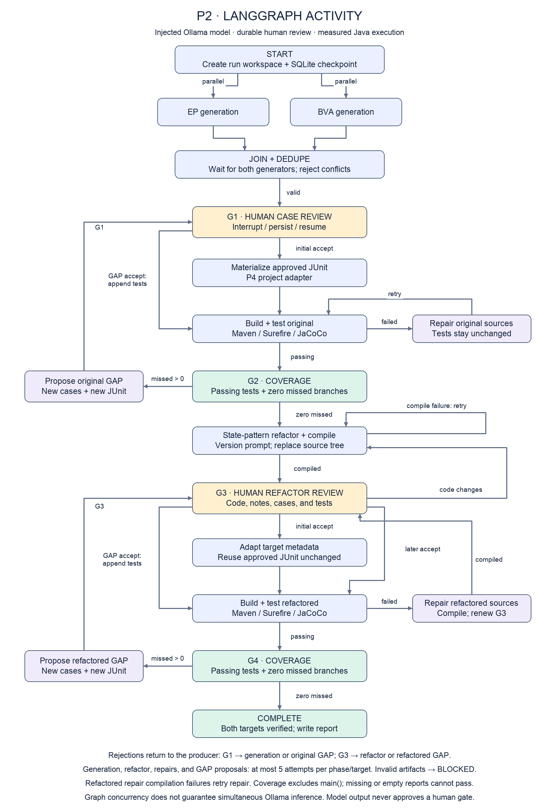

# CSE 4392/5320 — Multi-Agent System for Software Testing and Refactoring

Team assignment 3 tests and refactors `SeasonSwitch`, a three-state thermostat (`OFF`/`COOL`/`HEAT`).
The P2 LangGraph harness executes the team's skill prompts with parallel EP/BVA generation, durable human review, bounded repair loops, measured branch coverage, and a State-pattern refactor.
The main workflow skill remains [`.agents/orchestrator/SKILL.md`](.agents/orchestrator/SKILL.md).

## Setup

Use Python 3.11–3.14, [uv](https://docs.astral.sh/uv/), JDK 17, Maven, and an OpenAI-compatible model server.
The CLI supports macOS and Linux; Windows users can use WSL because the run lock uses `fcntl`.

```bash
# macOS, if these tools are not already installed
brew install uv maven openjdk@17
export JAVA_HOME="$(brew --prefix openjdk@17)/libexec/openjdk.jdk/Contents/Home"
export PATH="$JAVA_HOME/bin:$PATH"

uv sync --locked
```

The selected model is `groot`, served by a local llama.cpp server over the OpenAI API
(default `http://192.168.1.185:8080/v1`; override with `MODEL_BASE_URL`, `MODEL_NAME`,
and `MODEL_API_KEY`).
The graph dispatches EP and BVA concurrently, although the model server may queue requests depending on available resources and server configuration.

## Start and review

```bash
uv run python -m harness start --project seasonswitch
uv run python -m harness status --run runs/<run-id>
```

Each run copies the project into `runs/<run-id>/workspace/` and stops at a real LangGraph interrupt for G1 case review and G3 refactor review.
Read the artifacts named in `pending`, including any proposed supplemental tests.
After an actual review, save a decision JSON outside the evidence files using the current `artifact_sha256` from `status`:

```json
{
  "reviewer": "YOUR NAME",
  "decision": "accept",
  "requested_changes": [],
  "artifact_sha256": "COPY THE CURRENT HASH FROM STATUS"
}
```

To reject, use `"decision": "request_changes"` with nonempty feedback in `requested_changes`.
The CLI fills in the current gate and timestamp when omitted.
It rejects stale hashes and invalid decisions without consuming the pending interrupt.

```bash
uv run python -m harness resume --run runs/<run-id> --decision decision.json
```

SQLite checkpoints are the resume source; `STATE.md` and `status.json` are readable projections.
After an interrupted process, `resume --run ...` without a decision resumes unfinished execution when no human gate is pending.
A blocked run has ended: inspect its error and evidence, correct the cause, then start a new run.
Do not edit checkpoint or approval files to bypass a gate.

## Swap the model

```bash
ollama pull <another-model>
MODEL_NAME=<another-model> uv run python -m harness start --project seasonswitch
# Optional: OLLAMA_BASE_URL=http://localhost:11434
```

Model construction exists only in `harness/model.py`.
`build_graph(model=..., run=..., checkpointer=..., build_runner=...)` accepts any compatible LangChain runnable, so another provider or a deterministic test double can be injected without changing the graph.
Set the same model environment when resuming; each transcript records the model actually used.

## Verify

```bash
uv run python scripts/validate_skills.py
uv run ruff check harness tests scripts/render_activity.py
uv run pytest -q
```

The tests include SQLite restart at both gates, parallel fan-out/join, rejected and stale approvals, bounded retries, unchanged test reuse, and a real Maven/JaCoCo end-to-end fixture.
Fixture approvals and generated fixture code are test data, not assignment-run evidence.
Both coverage gates require passing, nonempty tests and zero missed branches; the coverage scope excludes `main()` as defined by P3.
Generated Java executes locally under Maven: the workspace protects repository files but is not an operating-system sandbox.

## Team boundaries

| Path | Owner | Responsibility |
| --- | --- | --- |
| `.agents/orchestrator/`, `harness/`, architecture and activity diagram | P2 / Loc | Runtime, gates, injection, persistence |
| `.agents/ep-tests/`, `.agents/bva-tests/` | P1 | Generation prompts |
| `.agents/testgen/`, `projects/` | P4 | Case merge, review helpers, JUnit adapter |
| `.agents/refactor-state/` | P5 | State-pattern prompt and mutation guidance |
| `java/`, build and coverage tooling, slides | P3 | Build infrastructure, evidence, presentation |

See [architecture](docs/ARCH.md), [contracts](docs/CONTRACTS.md), and the original [team plan](docs/TEAM-PLAN.md).
Existing teammate skills and project vocabulary remain the stage inputs.



Edit [the draw.io source](docs/activity.drawio), or regenerate both diagram artifacts with `uv run python scripts/render_activity.py`.
